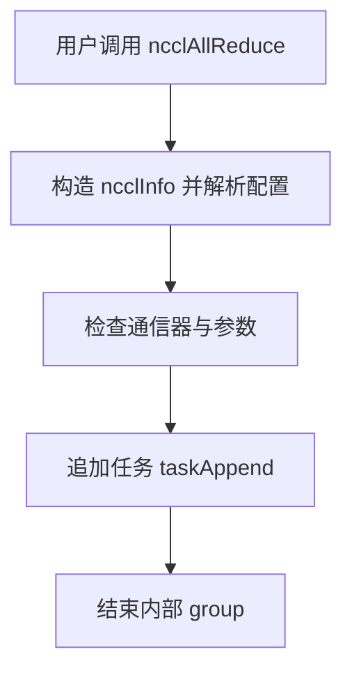

# NCCL 源码分析概览（局部人工核验）

分析对象：`D:\work\插件\third_party\nccl`。本报告基于当前目录中的源码静态分析；未执行 GPU、多进程或网络实测。

## 项目定位与构建

仓库 README 将 NCCL 描述为 GPU 通信库，列举 AllReduce、AllGather、Reduce、Broadcast、ReduceScatter 和收发通信，并说明可用于单机或多机 [[README.md:7]]。README 提供 `make -j src.build` 的构建示例及 CUDA_HOME 配置 [[README.md:15]] [[README.md:22]]；顶层 Makefile 将 `src.%` 目标转发至 `src` 子目录 [[Makefile:57]]。这些是源码给出的构建说明，本次没有执行编译。

## 通信器初始化与拓扑

公开接口 `ncclCommInitRank` 初始化环境、获取当前 CUDA 设备，以默认配置进入内部 group，并调用 `ncclCommInitRankDev`；退出时检查 group 错误并结束内部 group [[src/init.cc:3063]] [[src/init.cc:3070]] [[src/init.cc:3074]] [[src/init.cc:3081]]。初始化中的拓扑代码创建系统图，计算 GPU 与 NIC 的路径，裁剪不可访问或未使用的对象后重新计算路径，并初始化拓扑搜索 [[src/init.cc:1449]] [[src/init.cc:1452]] [[src/init.cc:1454]] [[src/init.cc:1457]]。这些步骤属于静态代码路径；具体设备及路径选择取决于运行环境，本次未确认。

## AllReduce 提交路径

`ncclAllReduce` 将用户缓冲区、元素数、数据类型、归约操作、通信器及 CUDA stream 转发给 `ncclAllReduceConfigImpl` [[src/collectives.cc:204]] [[src/collectives.cc:210]]。实现将参数装入 `ncclInfo`，解析配置，再调用 `ncclEnqueueCheck` [[src/collectives.cc:192]] [[src/collectives.cc:196]] [[src/collectives.cc:200]]。

`ncclEnqueueCheck` 首先检查通信器及撤销状态，启动内部 group，确保通信器就绪并执行参数检查；随后调用 `taskAppend`，递增操作计数，最后结束内部 group；源码注释指出当 group 深度为 1 时内部结束会触发 group 操作 [[src/enqueue/enqueue.cc:3570]] [[src/enqueue/enqueue.cc:3583]] [[src/enqueue/enqueue.cc:3587]] [[src/enqueue/enqueue.cc:3595]] [[src/enqueue/enqueue.cc:3605]] [[src/enqueue/enqueue.cc:3611]]。失败路径对非阻塞通信器的异步错误状态有特殊处理 [[src/enqueue/enqueue.cc:3617]]。

该图只表达上面已核验的主要提交步骤，不代表所有错误分支、算法选择或 GPU kernel 内部流程。

## group、线程与通信连接

`ncclKernelPlanner` 的注释将部分状态描述为在 `ncclGroupStart/End` 之间累积任务；结构中包括 collective 排序器、按 peer 的收发队列、任务计数及用户 stream 列表 [[src/include/comm.h:485]] [[src/include/comm.h:490]] [[src/include/comm.h:496]] [[src/include/comm.h:512]]。异步 job 在无 group 深度时直接执行；有 group 时会保存回调并加入队列，混用 blocking 与 nonblocking 通信器会返回无效参数 [[src/group.cc:40]] [[src/group.cc:55]] [[src/group.cc:65]]。`ncclGroupJobLaunch` 对单个 job 直接调用主函数，对多个 job 创建线程 [[src/group.cc:76]] [[src/group.cc:82]] [[src/group.cc:90]]。

传输表列出 P2P、共享内存、网络和 CollNet；`selectTransport` 遍历候选项，调用 `canConnect`，可连接时设置相应通信方法并执行 setup [[src/transport.cc:15]] [[src/transport.cc:22]] [[src/transport.cc:29]] [[src/transport.cc:33]]。`ncclTransportP2pConnect` 为符合条件的接收和发送 peer 设置待连接 channel 位；该函数本身不等于完整连接建立过程 [[src/transport.cc:46]] [[src/transport.cc:51]] [[src/transport.cc:58]]。例如 ring 连接先为前后 peer 标记连接，再调用 `ncclTransportP2pSetup` [[src/transport/generic.cc:14]] [[src/transport/generic.cc:24]] [[src/transport/generic.cc:28]]；tree 对上下游进行类似处理 [[src/transport/generic.cc:49]]。

## 索引与分析边界

插件索引了 1,034 个 C/C++/CUDA/Python 文件、312,726 行、19,043 个符号与 57,314 条候选调用边。调用边中 19,889 条标为 external、12,066 条 ambiguous；这些不是已证实的调用关系。并发索引产生的 52,709 条候选通信关系同样需要逐项查证。

生成计划包含 1,221 个工作包和 7,318 个笔记桩；由于规模很大，绝大多数桩没有经过人工分析，不应将其视为完成的源码解释。函数计划限制为 20 个，并非所有函数；选出的入口有不少位于 examples/contrib。HTML 中的索引、自动骨架、模板和人工完成的分析属于不同层次；空白或 TODO 表示尚未完成。解析器不是编译器前端，模板、宏生成代码、函数指针和条件编译等会影响覆盖与准确度。校验即使通过，也不能证明文字语义正确。
